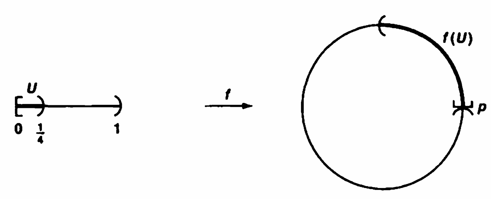

A subset $A$ of a topological space $X$ is said to be **<u>closed</u>** if the set $X-A$ is open.

Given a subset $A$ of a topological space $X$, the **<u>interior</u>** of $A$ is defined as the union of all open sets contained in $A$, and the **<u>closure</u>** of $A$ is defined as the intersection of all closed sets containing $A$.

They shorten the statement " $U$ is an open set containing $x$ " to the phrase " $U$ is a **<u>neighborhood</u>** of $x$ "

If $A$ is a subset of the topological space $X$ and if $x$ is a point of $X$, we say that $x$ is a **<u>limit point</u>** of $A$ if every neighborhood of $x$ intersects $A$ in some point other than $x$ itself. (We shall say that a set $A$ **<u>intersects</u>** a set $B$ if the intersection $A \cap B$ is not empty.)

**Thm 17.6.** Let $A$ be a subset of the topological space $X$, let $A'$ be the set of all limit points of $A$. Then $\bar{A}=A \cup A'$

**Key** : $x \in \bar{A} \iff$ every neighborhood of $x$ intersects $A$
$$
\begin{aligned}
\text{Left} &\iff \text{$\forall$ closed $C \supseteq A$, then $x \in C$} \\
&\iff \text{$\forall$ open $O \cap A = \varnothing$, then $x \notin O$}\\
&\xLeftrightarrow{\text{逆否命题}} \text{$\forall$ open $U \ni x$, then $U \cap A = \varnothing$}
\end{aligned}
$$

---

**Def.** A topological space $X$ is called a **<u>Hausdorff space</u>** if for each pair $x_1, x_2$ of distinct points of $X$, there exist neighborhoods $U_1$, and $U_2$ of $x_1$ and $x_2$, respectively, that are disjoint.

**Thm 17.8.** Every finite point set in a Hausdorff space $X$ is closed.
**Pf.** It suffices to show that every one-point set $\left\{x_0\right\}$ is closed. For all $y \ne x_0$, there exist $V_y \ni y$ which $x \notin V_y$.
Therefore, $\bigcup\limits_{y \ne x_0} V_y = \{x_0\}^c$ is open.

**<u>$T_1$ axiom condition</u>** : finite point sets be closed

$T_1$ condition is weaker than the Hausdorff condition : We can def a topology on $\R$ by $U$ is open $\iff$ $\R - U$ is finite. This is not a Hausdorff space, but it is a space in which finite point sets are closed.

---

Let $X$ and $Y$ be topological spaces. A function $f: X \to Y$ is said to be **<u>continuous</u>** if for each open subset $V$ of $Y$, the set $f^{-1}(V)$ is an open subset of $X$.

**Equivalent Def :** $f$ is continuous if for every closed set $B$ of $Y$, the set $f^{-1}(B)$ is closed in $X$
**key :** Note that $f^{-1}(Y) = X$ by definition

Let $X$ and $Y$ be topological spaces; let $f : X \to Y$ be a bijection. If both the function $f$ and the inverse function $f^{-1}: Y \to X$ are continuous, then $f$ is called a **<u>homeomorphism</u>**.

**Example 3.** Let $\R$ denote the set of real numbers in its usual topology, and let $\R_l$ denote the topology generated by $[a,b)$ (the lower limit topology). Def $f : \R \to \R_l$ by $f : x \mapsto x$ . Then $f$ is not a continuous function becasue the inverse image of the open set $[a, b)$ of $\R_l$ equals itself, which is not open in $\R$. On the other hand, the identity function $g : \R_l \to \R$ is continuous, because the inverse image of $(a, b)$ is itself, which is open in $\R_l$.

**Example 6.** A bijective function $f : X \to Y$ can be continuous without being a homeomorphism. One such function is Example 3. Another is the following Let $S^1 :=\left\{(x, y) | x^2+y^2=1\right\}$ , then considered as a subspace of the plane $\R^2$, and let $F : [0,1) \to S^1$ be the map defined by $f(t)=(\cos 2 \pi t, \sin 2 \pi t)$. Then $f$ is bijective and continuous. But the function $f^{-1}$ is not continuous. $f^{-1}[0,\frac14)$ is not open in $S^1$, for the point $p=f(0)$ lies in no open set $V$ of $\R^2$ such that $V \cap S^1 \subset f(U)$.

Now suppose that $f: X \to Y$ is an injective continuous map, where $X$ and $Y$ are topological spaces. Let $Z$ be the image set $f(X)$, considered as a subspace of $Y$; then the function $f': X \to Z$ obtained by restricting the range of $f$ is bijective. If $f'$ happens to be a homeomorphism of $X$ with $Z$, we say that the map $f: X \to Y$ is a topological imbedding, or simply an **<u>imbedding</u>**, of $X$ in $Y$.

---

**Def.** If $d$ is a metric on the set $X$, then the collection of all $\varepsilon$-balls $B_d(x, \epsilon)$, for $x \in X$ and $\varepsilon>0$, is a basis for a topology on $X$, called the metric topology induced by $d$.
