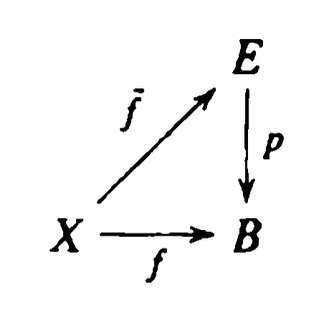

**Definition.** If $f$ and $f'$ are continuous maps of the space $X$ into the space $Y$, we say that $f$ is homotopic to $f'$ if there is a continuous map $F : X \times I \to Y$ such that
$$
F(x, 0)=f(x) \quad \text { and } \quad F(x, 1)=f'(x)
$$

for each $x$. (Here $I=[0,1]$.) The map $F$ is called a homotopy between $f$ and $f'$. If $f$ is homotopic to $f'$, we write $f \simeq f'$. If $f \simeq f'$ and $f'$ is a constant map, we say that $f$ is nulhomotopic.


**Definition.** Two paths $f$ and $f'$, mapping the interval $I=[0,1]$ into $X$, are said to be path homotopic if they have the same initial point $x_0$ and the same final point $x_1$, and if there is a continuous map $F: I \times I \to X$ such that
$$
\begin{array}{lll}
F(s, 0)=f(s) & \text { and } & F(s, 1)=f'(s), \\
F(0, t)=x_0 & \text { and } & F(1, t)=x_1,
\end{array}
$$

for each $s \in I$ and each $t \in I$. We call $F$ a path homotopy between $f$ and $f'$ See Figure 51.1. If $f$ is path homotopic to $f'$, we write $f \simeq_p f'$.


**Lemma 51.1.** The relations $\simeq$ and $\simeq_p$ are equivalence relations.
If $f$ is a path, we shall denote its path-homotopy equivalence class by $[f]$.


**Definition.** If $f$ is a path in $X$ from $x_0$ to $x_1$, and if $g$ is a path in $X$ from $x_1$ to $x_2$, we define the product $f * g$ of $f$ and $g$ to be the path $h$ given by the equations
$$
h(s)= \begin{cases}f(2 s) & \text { for } s \in\left[0, \frac12\right], \\ g(2 s-1) & \text { for } s \in\left[\frac12, 1\right] .\end{cases}
$$

The function $h$ is well-defined and continuous, by the pasting lemma; it is a path in $X$ from $x_0$ to $x_2$. We think of $h$ as the path whose first half is the path $f$ and whose second half is the path $g$.

**Remark.** $*$ 运算并不满足结合律
$$
((f * g) * h)(s)= \begin{cases}f(4 s), & 0 \le s \le \frac14 \\ g(4 s-1), & \frac14 \le s \le \frac12 \\ h(2 s-1), & \frac12 \le s \le 1\end{cases}
$$


三段路径所占时间分别为 $\frac14, \frac14, \frac12 .$


另一方面,

$$
(f *(g * h))(s)= \begin{cases}f(2 s), & 0 \le s \le \frac12 \\ g(4 s-2), & \frac12 \le s \le \frac34 \\ h(4 s-3), & \frac34 \le s \le 1\end{cases}
$$


三段路径所占时间分别为 $\frac12, \frac14, \frac14 .$

两条路径虽然都依次经过 $f, g, h$ , 但速度安排不同.

**Remark.** 两条路径相差一个重参数化, 即存在连续函数 $\varphi$ 使得 $((f * g) * h)(s)=(f *(g * h))(\varphi(s)) .$

并且重参数化的两条路径是通伦的 $f \circ \varphi \simeq f$.

定义 $H:[0,1] \times[0,1] \to X$ 为 $H(s, t)=f((1-t) \varphi(s)+t s) .$

当 $t=0$ 时, $H(s, 0)=f(\varphi(s))=(f \circ \varphi)(s)$ ; 当 $t=1$ 时, $H(s, 1)=f(s) .$ 即证两条路径通伦


**Prop.** The product operation on paths induces a well-defined operation on path-homotopy classes, defined by the equation
$$
[f] *[g]=[f * g]
$$
To verify this fact, let $F$ be a path homotopy between $f$ and $f'$ and let $G$ be a path homotopy between $g$ and $g'$. Define

$$
H(s, t)= \begin{cases}F(2 s, t) & \text { for } s \in\left[0, \frac12\right] \\ G(2 s-1, t) & \text { for } s \in\left[\frac12, 1\right]\end{cases}
$$

Because $F(1, t)=x_1=G(0, t)$ for all $t$, the map $H$ is well-defined; it is continuous by the pasting lemma.


**Theorem 51.2.** The operation * has the following properties:

(1) (Associativity) If $[f] *([g] *[h])$ is defined, so is $([f] *[g]) *[h]$, and they are equal.

(2) (Right and left identities) Given $x \in X$, let $e_x$ denote the constant path $e_x: I \to X$ carrying all of $I$ to the point $x$. If $f$ is a path in $X$ from $x_0$ to $x_1$, then
$$
[f] *\left[e_{x_1}\right]=[f] \quad \text { and } \quad\left[e_{x_0}\right] *[f]=[f] .
$$

(3) (Inverse) Given the path $f$ in $X$ from $x_0$ to $x_1$, let $\bar{f}$ be the path defined by $\bar{f}(s)=f(1-s)$. It is called the reverse of $f$ Then

$$
[f] *[\bar{f}]=\left[e_{x_0}\right] \quad \text { and } \quad[\bar{f}] *[f]=\left[e_{x_1}\right] .
$$


**Definition.** Let $X$ be a space; let $x_0$ be a point of $X$. A path in $X$ that begins and ends at $x_0$ is called a loop based at $x_0$. The set of path homotopy classes of loops based at $x_0$, with the operation $*$, is called the fundamental group of $X$ relative to the base point $x_0$. It is denoted by $\pi_1\left(X, x_0\right)$.

**Example.** If $X$ is any convex subset of $\R^n$, then $\pi_1\left(X, x_0\right)$ is the trivial group.


**Definition.** Let $\alpha$ be a path in $X$ from $x_0$ to $x_1$. We define a map $\hat{\alpha}: \pi_1\left(X, x_0\right) \longrightarrow \pi_1\left(X, x_1\right)$ by the equation
$$
\hat{\alpha}([f])=[\bar{\alpha}] *[f] *[\alpha] .
$$
$[\bar{\alpha}]$ denotes the inverse of $[\alpha]$


---

**Definition.** Let $p : E \to B$ be a continuous surjective map. The open set $U$ of $B$ is said to be evenly covered by $p$ if the inverse image $p^{-1}(U)$ can be written as the union of disjoint open sets $V_\alpha$ in $E$ such that for each $\alpha$, the restriction of $p$ to $V_\alpha$ is a homeomorphism of $V_\alpha$ onto $U$ The collection $\left\{V_\alpha\right\}$ will be called a partition of $p^{-1}(U)$ into slices.

**Example.**  标准投影为 $p: \R^3 \to \R^2, \quad p(x, y, z)=(x, y)$ 是连续满射, 但不是 covering map.

假设存在非空开集 $U \subseteq \R^2$ 被 $p$ evenly covered, 则 $p^{-1}(U)=U \times \R$ 可以分解成两两不交的开集 $V_\alpha$ , 并且每个限制 $\left.p\right|_{V_\alpha}: V_\alpha \to U$ 都是同胚, 特别地必须是单射. 但是, 任取某个非空的 $V_\alpha$ , 取一点 $\left(x_0, y_0, z_0\right) \in V_\alpha .$

因为 $V_\alpha$ 是 $\R^3$ 中的开集, 所以存在 $\varepsilon>0$ , 使得三维开球 $B_\varepsilon\left(x_0, y_0, z_0\right) \subseteq V_\alpha .$ 于是当 $0<|\delta|<\varepsilon$ 时, $\left(x_0, y_0, z_0+\delta\right) \in V_\alpha .$

但 $p\left(x_0, y_0, z_0\right)=\left(x_0, y_0\right)=p\left(x_0, y_0, z_0+\delta\right)$ 说明 $\left.p\right|_{V_\alpha}$ 不是单射, 与它是同胚矛盾.


**Definition.** Let $p : E \to B$ be continuous and surjective. If every point $b$ of $B$ has a neighborhood $U$ that is evenly covered by $p$, then $p$ is called a <u>covering map</u>, and $E$ is said to be a covering space of $B$

**Example.** 考虑映射 $p : \R \to S^1, \quad p(t)=e^{2 \pi i t},$

任取 $z_0 \in S^1$ , 选择 $t_0 \in \R$ 使得 $z_0=e^{2 \pi i t_0}$ . 再取 $0<\varepsilon<\frac12$ , 令 $U$ 是 $z_0$ 的一个开邻域

$$
U=\left\{e^{2 \pi i s}:t_0-\varepsilon<s<t_0+\varepsilon\right\}.
$$

则

$$
p^{-1}(U)=\coprod_{n \in \Z}\left(t_0-\varepsilon+n, t_0+\varepsilon+n\right).
$$

这些开区间两两不交, 而且对于每个 $n \in \Z$ , 限制映射 $\left.p\right|_{\left(t_0-\varepsilon+n, t_0+\varepsilon+n\right)} : \left(t_0-\varepsilon+n, t_0+\varepsilon+n\right) \to U$ 都是同胚. 因此 $U$ 被 $p$ evenly covered. 由于每个 $z_0 \in S^1$ 都有这样的邻域, $p$ 是 covering map.

**Example.** $T^2$ 是甜甜圈表面.
$$
p: \R^2 \longrightarrow T^2=S^1 \times S^1, \quad p(x, y)=\left(e^{2 \pi i x}, e^{2 \pi i y}\right) .
$$

取环面上的一点 $z_0=\left(e^{2 \pi i x_0}, e^{2 \pi i y_0}\right) .$ 在 $z_0$ 附近取一个足够小的开邻域 $U$ , 其原像可以写成

$$
p^{-1}(U)=\bigsqcup_{(m, n) \in \Z^2} U_{m, n}
$$

其中每个 $U_{m, n}=U_{0,0}+(m, n).$ 而且每个限制 $\left.p\right|_{U_{m, n}}: U_{m, n} \longrightarrow U$ 都是同胚.


**Proposition 1.5 (Change of basepoint, Hatcher).** 设 $X$ 是任意拓扑空间, $x_0,x_1\in X$ 并且存在连续道路 $h:I=[0,1]\longrightarrow X$ 满足 $h(0)=x_0,\quad h(1)=x_1.$ 换句话说, $x_0$ 与 $x_1$ 位于 $X$ 的同一个道路连通分支中. 令反向道路为 $\bar h(s)=h(1-s).$ 则
$$
\beta_h:\pi_1(X,x_1)\longrightarrow\pi_1(X,x_0), \qquad \beta_h([f])=[h\cdot f\cdot\bar h]
$$
是群同构, 其逆映射为
$$
\beta_{\bar h}:\pi_1(X,x_0)\longrightarrow\pi_1(X,x_1).
$$
**Proof.** We see first that $\beta_h$ is a homomorphism since $\beta_h[f \cdot g]=[h \cdot f \cdot g \cdot \bar{h}]=$ $[h \cdot f \cdot \bar{h} \cdot h \cdot g \cdot \bar{h}]=\beta_h[f] \beta_h[g]$. Further, $\beta_h$ is an isomorphism with inverse $\beta_{\bar{h}}$ since $\beta_h \beta_{\bar{h}}[f]=\beta_h[\bar{h} \cdot f \cdot h]=[h \cdot \bar{h} \cdot f \cdot h \cdot \bar{h}]=[f]$, and similarly $\beta_{\bar{h}} \beta_h[f]=[f]$.

**Remark.** 当 $X$ 是道路连通的, 任意 $x_0,x_1\in X$ 之间都有道路 $h$，于是 $\pi_1(X,x_0)\cong\pi_1(X,x_1).$ 因此，在基本群同构意义下, 简写为 $\pi_1(X).$


**Definition.** Let $p : E \to B$ be a map. If $f : X \to B$ is continuous, a lifting of $f$ is a map $\bar{f}: X \to E$ such that $p \circ \bar{f}=f$.




**Lemma 54.1.** Let $p: E \to B$ be a covering map, let $p\left(e_0\right)=b_0$. Any path $f : [0,1] \to B$ beginning at $b_0$ has a unique lifting to a path $\bar{f}$ in $E$ beginning at $e_0$.

**存在性.** 因为 $p$ 是覆盖映射, 所以对于每个 $t \in[0,1]$ , 点 $f(t) \in B$ 都有一个被 $p$ 均匀覆盖的开邻域 $U_t$ . 即
$$
p^{-1}\left(U_t\right)=\coprod_\alpha V_{t, \alpha},
$$

其中每个 $V_{t, \alpha}$ 都是 $E$ 中的开集, 并且 $\left.p\right|_{V_{t, \alpha}}: V_{t, \alpha} \to U_t$ 是同胚.

由于 $f$ 连续, $f^{-1}\left(U_t\right)$ 是 $[0,1]$ 中包含 $t$ 的开集. 因此 $\left\{f^{-1}\left(U_t\right): t \in[0,1]\right\}$ 构成 $[0,1]$ 的一个开覆盖.

因为 $[0,1]$ 是紧致度量空间, 根据 Lebesgue 数引理, 存在足够小的 $\delta > 0$ 使得任意 $x$ 均存在 $t$ 使得 $B(x, \delta) \sube f^{-1}(U_t)$

因此存在有限分割 $0=s_0<s_1<\cdots<s_n=1$ 使得每个 $i=1, \cdots, n$ , 存在一个被均匀覆盖的开集 $U_i$ , 满足 $f\left(\left[s_{i-1}, s_i\right]\right) \subseteq U_i .$

(取 $s_i - s_{i - 1} < \delta$ 即可)

- 首先看区间 $\left[s_0, s_1\right]$ . 因为 $f\left(s_0\right)=f(0) \in U_0$ , 所以 $e_0 \in p^{-1}\left(U_0\right) .$ 在 $p^{-1}\left(U_0\right)$ 的切片分解中, 存在唯一一个切片 $V_0$ 包含 $e_0$ . 限制映射 $\left.p\right|_{V_0}: V_0 \to U_0$ 是同胚, 因此有连续的逆映射 $\left(\left.p\right|_{V_0}\right)^{-1}: U_0 \to V_0 .$ 定义
  $$
  \bar{f}(t)=\left(\left.p\right|_{V_1}\right)^{-1}(f(t)), \quad t \in\left[s_0, s_1\right] .
  $$

  于是 $p(\bar{f}(t))=f(t), \quad t \in [s_0, s_1]$

- 假设已经在 $\left[0, s_i\right]$ 上构造了提升. 记它在端点的值为 $e_i=\bar{f}\left(s_i\right) .$ 由于 $p\left(e_i\right)=f\left(s_i\right) \in U_i,$ 所以 $e_i \in p^{-1}\left(U_i\right)$ . 在 $p^{-1}\left(U_i\right)$ 的切片分解中, 存在唯一一个切片 $V_i$ 包含 $e_i$ . 定义

  $$
  \bar{f}(t)=\left(\left.p\right|_{V_i}\right)^{-1}(f(t)), \quad t \in \left[s_i, s_{i + 1}\right]
  $$

  在连接点 $s_{i-1}$ 处, 新定义给出的值为 $\left(\left.p\right|_{V_i}\right)^{-1}\left(f\left(s_{i-1}\right)\right)=e_{i-1}$ 恰好等于前一段提升的终点.


逐段进行, 最终得到 $\bar{f}:[0,1] \to E .$ 由有限粘贴引理,  $\bar{f}$ 连续. 同时, $p \circ \bar{f}=f, \quad \bar{f}(0)=e_0$ 所以提升存在.

**唯一性.** 假设 $\bar{f}, \tilde{f}:[0,1] \to E$ 都是 $f$ 的提升, 并且具有相同的起点
$$
p \circ \bar{f}=f, \quad p \circ \tilde{f}=f, \quad \bar{f}(0)=\tilde{f}(0)=e_0 .
$$


往证 $\bar{f}=\tilde{f} .$ 定义 $S=\{t \in[0,1]: \bar{f}(t)=\tilde{f}(t)\} .$ 显然 $0 \in S,$ 所以 $S \neq \varnothing$ .

下面证明 $S$ 和它的补集都是开集.

- 任取 $t_0 \in S$. 于是 $\bar{f}\left(t_0\right)=\tilde{f}\left(t_0\right)=e .$ 选择 $f\left(t_0\right)=p(e)$ 的一个均匀覆盖邻域 $U$ , $p^{-1}(U)=\coprod_\alpha V_\alpha .$

设 $e \in V_{\alpha_0}$ , 由于 $f, \bar{f}, \tilde{f}$ 都连续, 并且 $U, V_{\alpha_0}$ 都是开集, 所以存在 $t_0$ 在 $[0,1]$ 中的一个开邻域 $J$ , 使得当 $t \in J$ 时,
$$
f(t) \in U, \quad \bar{f}(t) \in V_{\alpha_0}, \quad \tilde{f}(t) \in V_{\alpha_0} .
$$


而在 $V_{\alpha_0}$ 上, $p$ 是单射. 又因为两者都是 $f$ 的提升, $p(\bar{f}(t))=f(t)=p(\tilde{f}(t)) .$

因此 $\bar{f}(t)=\tilde{f}(t), \quad t \in J$ , 所以 $J \subseteq S$ , 从而 $S$ 是开集.

- 任取 $t_0 \notin S$ , 于是 $\bar{f}\left(t_0\right) \neq \tilde{f}\left(t_0\right) .$ 选择 $f\left(t_0\right)$ 的一个均匀覆盖邻域 $U$ , $p^{-1}(U)=\coprod_\alpha V_\alpha .$

因为 $p\left(\bar{f}\left(t_0\right)\right)=f\left(t_0\right)=p\left(\tilde{f}\left(t_0\right)\right),$ 但两点不相等, 因此存在不同的切片 $V_\alpha, V_\beta$ 使得
$$
\bar{f}\left(t_0\right) \in V_\alpha, \quad \tilde{f}\left(t_0\right) \in V_\beta, \quad \alpha \neq \beta .
$$


利用连续性, 存在 $t_0$ 的一个邻域 $J$ , 使得 $\bar{f}(J) \subseteq V_\alpha, \quad \tilde{f}(J) \subseteq V_\beta .$ 而 $V_\alpha \cap V_\beta=\varnothing$ , 所以对于所有 $t \in J$ , $\bar{f}(t) \neq \tilde{f}(t) .$

因此 $J \subseteq[0,1] \backslash S$ , 所以补集 $[0,1] \backslash S$ 也是开集. 即证唯一性.


---

**Definition-Theorem.** Let $p: E \to B$ be a covering map; let $b_0 \in B$ Choose $e_0$ so that $p\left(e_0\right)=b_0$. Given an element $[f]$ of $\pi_1\left(B, b_0\right)$, let $\bar{f}$ be the lifting of $f$ to a path in $E$ that begins at $e_0$. Let $\phi([f])$ denote the end point $\tilde{f}(1)$ of $\tilde{f}$. Then $\phi$ is a well-defined set map
$$
\phi: \pi_1\left(B, b_0\right) \to p^{-1}\left(b_0\right) .
$$

We call $\phi$ the lifting correspondence derived from the covering map $p$. It depends of course on the choice of the point $e_0$.

**Lemma 54.2.** Let $p: E \to B$ be a covering map; let $p\left(e_0\right)=b_0$. Let the map $F: I \times I \to B$ be continuous, with $F(0,0)=b_0$. There is a unique lifting of $F$ to a continuous map
$$
\tilde{F}: I \times I \to E
$$

such that $\bar{F}(0,0)=e_0$. If $F$ is a path homotopy, then $\tilde{F}$ is a path homotopy.

**Lemma 54.3.** Let $p : E \to B$ be a covering map; let $p\left(e_0\right)=b_0$. Let $f$ and $g$ be two paths in $B$ from $b_0$ to $b_1$, let $\tilde{f}$ and $\tilde{g}$ be their respective liftungs to paths in $E$ beginning at $e_0$. If $f$ and $g$ are path homotopic, then $\tilde{f}$ and $\tilde{g}$ end at the same point of $E$ and are path homotopic.

**Proof.** Let $F: I \times I \to B$ be the path homotopy between $f$ and $g$. Then $F(0,0)=$ $b_0$ Let $\bar{F}: I \times I \to E$ be the lifting of $F$ to $E$ such that $\bar{F}(0,0)=e_0$. By the preceding lemma, $\bar{F}$ is a path homotopy, so that $\bar{F}(0 \times I)=\left\{e_0\right\}$ and $\bar{F}(1 \times I)$ is a one-point set $\left\{e_1\right\}$.

The restriction $\bar{F} | I \times 0$ of $\bar{F}$ to the bottom edge of $I \times I$ is a path on $E$ beginning at $e_0$ that is a lifting of $F | I \times 0$. By uniqueness of path liftings, we must have $\bar{F}(s, 0)=$ $\tilde{f}(s)$. Similarly, $\bar{F} | I \times 1$ is a path on $E$ that is a lifting of $F | I \times 1$, and it begins at $e_0$ because $\bar{F}(0 \times I)=\left\{e_0\right\}$. By uniqueness of path liftings, $\tilde{F}(s, 1)=\tilde{g}(s)$ Therefore, both $\bar{f}$ and $\bar{g}$ end at $e_1$, and $\bar{F}$ is a path homotopy between them.


**Theorem 54.4.** Let $p: E \to B$ be a covering map; let $p\left(e_0\right)=b_0$. If $E$ is path connected, then the lifting correspondence
$$
\phi: \pi_1\left(B, b_0\right) \to p^{-1}\left(b_0\right)
$$

is surjective. If $E$ is simply connected, it is bijective.
**Proof.** If $E$ is path connected, then, given $e_1 \in p^{-1}\left(b_0\right)$, there is a path $\bar{f}$ in $E$ from $e_0$ to $e_1$. Then $f=p \circ \tilde{f}$ is a loop in $B$ at $b_0$, and $\phi([f])=e_1$ by definition

Suppose $E$ is simply connected. Let $[f]$ and $[g]$ be two elements of $\pi_1\left(B, b_0\right)$ such that $\phi([f])=\phi([g])$. Let $\bar{f}$ and $\bar{g}$ be the liftings of $f$ and $g$, respectively, to paths in $E$ that begin at $e_0$, then $f(1)=\bar{g}(1)$. Since $E$ is simply connected, there is a path homotopy $\tilde{F}$ in $E$ between $\tilde{f}$ and $\tilde{g}$. Then $p \circ \tilde{F}$ is a path homotopy in $B$ between $f$ and $g$


**Theorem.** 设 $p:E\to X$ 是覆盖映射, 并记 $E_x=p^{-1}(x), \quad E_y=p^{-1}(y).$ 如果 $X$ 路径连通, 则任意路径 $\gamma: x \to y$ 给出一个具体同构 $T_\gamma: E_x \xrightarrow{\sim} E_y,$

**Proof.** 给定一条路径 $\gamma:[0,1]\to X, \quad \gamma(0)=x,\quad \gamma(1)=y.$

任取 $e\in E_x$. 因为 $p(e)=x=\gamma(0),$ 路径提升定理保证存在唯一的路径 $\widetilde{\gamma}_e:[0,1]\to E$ 满足 $\widetilde{\gamma}_e(0)=e$ 以及 $p\circ\widetilde{\gamma}_e=\gamma.$

因为 $\gamma(1)=y$, 所以 $p\left(\widetilde{\gamma}_e(1)\right) = \gamma(1) = y.$ 因此提升路径的终点 $\widetilde{\gamma}_e(1)\in E_y.$ 定义 $T_\gamma:E_x\to E_y, \quad T_\gamma(e)=\widetilde{\gamma}_e(1).$

下面证明 $T_\gamma$ 是双射.

考虑反向路径 $\overline{\gamma}(t)=\gamma(1-t)$ 是一条从 $y$ 到 $x$ 的路径. 同样可以定义 $T_{\overline{\gamma}}:E_y\to E_x.$

假设 $T_\gamma(e)=e'$ , 即 $\widetilde{\gamma}_e$ 是一条从 $e$ 到 $e'$ 的提升路径. 考虑路径 $\overline{\widetilde{\gamma}_e}(t) = \widetilde{\gamma}_e(1-t)$ 满足 $p\circ\overline{\widetilde{\gamma}_e} = \overline{\gamma},$ 并且从 $e'$ 出发.

因此它是 $\overline{\gamma}$ 从 $e'$ 出发的唯一提升. 其终点是 $e$, 所以 $T_{\overline{\gamma}}(e')=e.$

由此, $T_{\overline{\gamma}}\circ T_\gamma = \operatorname{id}_{E_x}.$ 同理, $T_\gamma\circ T_{\overline{\gamma}} = \operatorname{id}_{E_y}$, 即证双射.

---

**Definition.** Let $I=[0,1]$ and $f: I \to \mathbb{R}^2$ be a loop, and let $a$ be a point not in the image of $f$. Set
$$
g(s) = (f(s)-a) /\|f(s)-a\| ;
$$

then $g:I \to S^1$ is a loop in $S^1$. Let $p: \mathbb{R} \rightarrow S^1$ be the standard covering map, and let $\tilde{g} : I \to \R$ be a lifting of $g$ to $S^1$. Because $g$ is a loop, the difference $\tilde{g}(1)-\tilde{g}(0)$ is an integer. This integer is called the winding number of $f$ with respect to $a$, and is denoted $n(f, a)$. Note that $n(f, a)$ is independent of the choice of the lifting of $g$. For if $\bar{g}$ is one lifting of $g$, then uniqueness of liftings implies that any other lifting of $g$ has the form $\bar{g}(s)+m$ for some integer $m$.


```latex
\begin{tikzcd}
	\R & {S^1} \\
	I
	\arrow["p", from=1-1, to=1-2]
	\arrow["{\tilde{g}}", from=2-1, to=1-1]
	\arrow["g"', from=2-1, to=1-2]
\end{tikzcd}
```


**Example.** loop 是一个 circle, $a$ 在圈外边, 此时 winding = 0


**Lemma 66.3.** Let $f$ be a piecewise-differentiable loop in the complex plane; let a be a point not in the image of $f$. Then
$$
n(f, a)=\frac{1}{2 \pi i} \int_f \frac{d z}{z-a}
$$

This equation is often used as the definition of the winding number of $f$.

**Proof.** Let $p: \mathbb{R} \rightarrow S^1$ be the standard covering map. Let $r(s)=\|f(s)-a\|$ and $g(s)= (f(s)-a) / r(s)$. 

Let $\tilde{g}$ be a lifting of $g$ to $\mathbb{R}$. Then $g(t)=e^{2 \pi i \tilde{g}(t)}$
$$
n(f, a)=\tilde{g}(1)-\tilde{g}(0) .
$$

令 $r(t)=|f(t)-a| .$ 则

$$
f(t)-a=r(t) g(t)=r(t) e^{2 \pi i \tilde{g}(t)}
$$

因此

$$
f^{\prime}(t)=r^{\prime}(t) e^{2 \pi i \widetilde{g}(t)}+r(t) e^{2 \pi i \widetilde{g}(t)} \cdot 2 \pi i \widetilde{g}^{\prime}(t) .
$$

于是

$$
\begin{aligned}
\int_f \frac{d z}{z-a}
&=\int_0^1 \frac{f^{\prime}(t)}{f(t)-a} d t = \int_0^1 \left[\frac{r^{\prime}(t)}{r(t)}+2 \pi i \tilde{g}^{\prime}(t)\right]~dt \\[1ex]
&= \log r(1)-\log r(0) + 2\pi i \left[\tilde{g}(1)-\tilde{g}(0)\right]
=2\pi i \cdot n(f, a) 
\end{aligned}
$$

