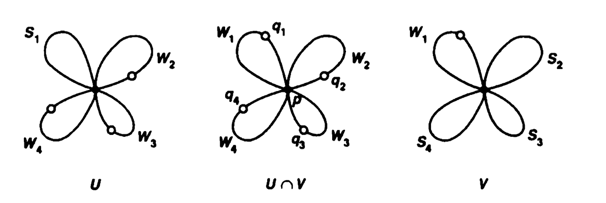
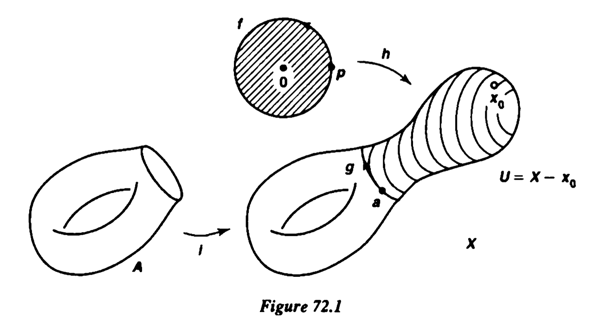

**Theorem 59.1.** Suppose $X=U \cup V$, where $U$ and $V$ are open sets of $X$. Suppose that $U \cap V$ is path connected, and that $x_0 \in U \cap V$. Let $i$ and $j$ be the inclusion mappings of $U$ and $V$, respectively, into $X$. Then the images of the induced homomorphisms
$$
i_*: \pi_1\left(U, x_0\right) \to \pi_1\left(X, x_0\right) \quad \text { and } \quad j_*: \pi_1\left(V, x_0\right) \to \pi_1\left(X, x_0\right)
$$

generate $\pi_1\left(X, x_0\right)$.

**Proof.** This theorem states that, given any loop $f$ in $X$ based at $x_0$, it is path homotopic to a product of the form $\left(g_1 *\left(g_2 *\left(\cdots * g_n\right)\right)\right)$, where each $g_i$ is a loop in $X$ based at $x_0$ that lies either in $U$ or in $V$.

Step 1. We show there is a subdivision $a_0<a_1<\cdots<a_n$ of the unit interval such that $f\left(a_i\right) \in U \cap V$ and $f\left(\left[a_{i-1}, a_i\right]\right)$ is contained either in $U$ or in $V$, for each $i$.

To begin, choose a subdivision $b_0, \cdots, b_m$ of $[0,1]$ such that for each $i$, the set $f\left(\left[b_{i-1}, b_i\right]\right)$ is contained in either $U$ or $V$. (Use the Lebesgue number lemma.) If $f\left(b_i\right)$ belongs to $U \cap V$ for each $i$, we are finished. If not, let $i$ be an index such that $f\left(b_i\right) \notin U \cap V$. Each of the sets $f\left(\left[b_{i-1}, b_i\right]\right)$ and $f\left(\left[b_i, b_{i+1}\right]\right)$ lies either in $U$ or in $V$. If $f\left(b_i\right) \in U$, then both of these sets must lie in $U$; and if $f\left(b_i\right) \in V$, both of them must lie in $V$. In either case, we may delete $b_i$, obtaining a new subdivision $c_0$, $\cdots, c_{m-1}$ that still satisfies the condition that $f\left(\left[c_{i-1}, c_i\right]\right)$ is contained either in $U$ or in $V$, for each $i$.

A finite number of repetitions of this process leads to the desired subdivision.
Step 2. We prove the theorem. Given $f$, let $a_0, \cdots, a_n$ be the subdivision constructed in Step 1. Define $f_i$ to be the path in $X$ that equals the positive linear map of [0, 1] onto $\left[a_{i-1}, a_i\right]$ followed by $f$. Then $f_i$ is a path that lies either in $U$ or in $V$, and
$$
[f]=\left[f_1\right] *\left[f_2\right] * \cdots *\left[f_n\right] .
$$

For each $i$, choose a path $\alpha_i$ in $U \cap V$ from $x_0$ to $f\left(a_i\right)$. (Here we use the fact that $U \cap V$ is path connected.) Since $f\left(a_0\right)=f\left(a_n\right)=x_0$, we can choose $\alpha_0$ and $\alpha_n$ to be the constant path at $x_0$.

Now we set $g_i=\left(\alpha_{i-1} * f_i\right) * \overline{\alpha_i}$ for each $i$. ($x_0 \xrightarrow{\alpha_{i-1}} f\left(a_{i-1}\right) \xrightarrow{f_i} f\left(a_i\right) \xrightarrow{\overline{\alpha_i}} x_0 .$)

 Then $g_i$ is a loop in $X$ based at $x_0$ whose image lies either in $U$ or in $V$. Direct computation shows that
$$
\left[g_1\right] *\left[g_2\right] * \cdots *\left[g_n\right]=\left[f_1\right] *\left[f_2\right] * \cdots *\left[f_n\right] .
$$

**Theorem 70.1 (Seifert-van Kampen theorem).** Let $X=U \cup V$, where $U$ and $V$ are open in $X$; assume $U, V$, and $U \cap V$ are path connected; let $x_0 \in U \cap V$. Let $H$ be a group, and let
$$
\phi_1: \pi_1\left(U, x_0\right) \longrightarrow H \quad \text { and } \quad \phi_2: \pi_1\left(V, x_0\right) \longrightarrow H
$$

be homomorphisms. Let $i_1, i_2, j_1, j_2$ be the homomorphisms indicated in the following diagram, each induced by inclusion.
If $\phi_1 \circ i_1=\phi_2 \circ i_2$, then there is a unique homomorphism $\Phi: \pi_1\left(X, x_0\right) \to H$ such that $\Phi \circ j_1=\phi_1$ and $\Phi \circ j_2=\phi_2$.

**Toy Example.** 假设 $X = A \cup B$  , 已经定义两个函数 $f_A : A \to Y, \quad f_B: B \to Y,$

如果二者在交集上相同, $\left.f_A\right|_{A \cap B} = \left.f_B\right|_{A \cap B} .$ 则定义 $f(x)= \begin{cases}f_U(x), & x \in U, \\ f_V(x), & x \in V .\end{cases}$ 将二者拼成一个函数 $f: X \to Y$ .

**Uniqueness.** Theorem 59.1 tells us that $\pi_1\left(X, x_0\right)$ is generated by the images of $j_1$ and $j_2$. The value of $\Phi$ on the generator $j_1\left(g_1\right)$ must equal $\phi_1\left(g_1\right)$, and its value on $j_2\left(g_2\right)$ must equal $\phi_2\left(g_2\right)$. Hence $\Phi$ is completely determined by $\phi_1$ and $\phi_2$.

**Existence.** For convenience, we introduce the following notation: Given a path $f$ in $X$, we shall use $[f]$ to denote its path-homotopy class in $X$. If $f$ happens to lie in $U$, then $[f]_U$ is used to denote its path-homotopy class in $U$. The notations $[f]_V$ and $[f]_{U \cap V}$ are defined similarly.

**Step1.** 对每个 $x\in X$, 选择一条从 $x_0$ 到 $x$ 的路径 $\alpha_x:x_0\to x$ 满足

- 若 $x\in U\cap V$, 令 $\alpha_x$ 完全位于 $U\cap V$;
- 若 $x\in U\setminus V$, 令 $\alpha_x$ 完全位于 $U$;
- 若 $x\in V\setminus U$, 令 $\alpha_x$ 完全位于 $V$;
- 令 $\alpha_{x_0}$ 为常值路径.

先设 $c:x\to y$ 是一条完全位于 $U$ 或完全位于 $V$ 中的路径.

- 若 $c\subseteq U$, 定义 $\omega(c)=\phi_1\bigl([\alpha_x*c*\overline{\alpha_y}]_U\bigr).$
- 若 $c\subseteq V$, 定义 $\omega(c)=\phi_2\bigl([\alpha_x*c*\overline{\alpha_y}]_V\bigr).$

- 如果 $c\subseteq U\cap V$, $\alpha_x,c,\alpha_y$ 都位于 $U\cap V$. 兼容条件 $\phi_1\circ i_1=\phi_2\circ i_2$ 保证 $\omega(c)$ 定义良好.

**Claim.** $\omega$ 满足以下性质:

1. 若 $e_x$ 是常值路径, 则 $\omega(e_x)=1$ 并且 $\omega(\overline{c})=\omega(c)^{-1}.$
2. 如果 $c$ 和 $d$ 在 $U$ 中或在 $V$ 中端点固定同伦, 则 $\omega(c)=\omega(d).$
3. 如果 $c:x\to y$ 和 $d:y\to z$ 位于同一个 $U$ 或同一个 $V$ 中, 则 $\omega(c*d)=\omega(c)\omega(d).$

**Proof.** 性质3 来自
$$
(\alpha_x*c*\overline{\alpha_y})
*(\alpha_y*d*\overline{\alpha_z})
\simeq_p
\alpha_x*(c*d)*\overline{\alpha_z}
$$
**Step2.** 设 $f$ 是 $X$ 中任意一条路径. 选择一个分割 $0=s_0<s_1<\cdots<s_n=1,$ 使得 $f$ 在每个区间 $[s_{r-1},s_r]$ 上的像完全位于
$U$ 或完全位于 $V$. 令 $f_r$ 是相应的小段路径, 定义 $T(f)=\omega(f_1)\omega(f_2)\cdots\omega(f_n).$

这个定义与分割无关. 事实上, 如果在某一小段 $f_r$ 中增加一个分点, 将它分成 $f_r'$ 和 $f_r''$, 有 $f_r\simeq_p f_r'*f_r''$ 发生在同一个 $U$ 或 $V$ 中, 因此 $\omega(f_r)=\omega(f_r')\omega(f_r'').$ 所以加细分割不会改变 $T(f)$. 而任意两个分割都有共同加细, 因此 $T(f)$ 与分割的选择无关.

同样, 若 $f*g$ 有定义, 只要选择包含拼接点的分割, 即得 $T(f*g)=T(f)T(g).$

设 $F:I\times I\to X$ 是从路径 $f$ 到路径 $g$ 的端点固定同伦, 往证 $T(f)=T(g).$

集合 $F^{-1}(U)$ 和 $F^{-1}(V)$ 构成紧空间 $I\times I$ 的开覆盖. 由 Lebesgue number lemma, 可以选择分割
$$
0=s_0<s_1<\cdots<s_m=1,\qquad
0=t_0<t_1<\cdots<t_n=1,
$$
使得每个小矩形
$$
R_{ij}=[s_{i-1},s_i]\times[t_{j-1},t_j]
$$
在 $F$ 下的像完全位于 $U$ 或完全位于 $V$ 中.

对每个网格点, 令 $h_i^j$ 表示路径 $F|_{[s_{i-1},s_i]\times\{t_j\}}$, 方向从左到右; 令 $v_i^j$ 表示路径 $F|_{\{s_i\}\times[t_{j-1},t_j]}$, 方向从下到上. 这些路径均重新参数化到 $I$ 上.

在小矩形 $R_{ij}$ 中, 从左下角到右上角的两条路径满足
$$
h_i^{j-1}*v_i^j\simeq_p v_{i-1}^j*h_i^j.
$$
此同伦发生在同一个 $U$ 或同一个 $V$ 中, 因此由 $\omega$ 的性质得
$$
\omega(h_i^{j-1})\omega(v_i^j)
=\omega(v_{i-1}^j)\omega(h_i^j),
$$
从而
$$
\omega(h_i^j)
=\omega(v_{i-1}^j)^{-1}\omega(h_i^{j-1})\omega(v_i^j).
$$

固定 $j$, 按 $i=1,\cdots,m$ 的顺序相乘. 中间的竖边项依次消去, 得
$$
\prod_{i=1}^m\omega(h_i^j)
=\omega(v_0^j)^{-1}
\left(\prod_{i=1}^m\omega(h_i^{j-1})\right)
\omega(v_m^j).
$$
因为 $F$ 是端点固定同伦, $v_0^j$ 和 $v_m^j$ 都是常值路径. 所以 $\omega(v_0^j)=\omega(v_m^j)=1$, 进而
$$
\prod_{i=1}^m\omega(h_i^j)
=\prod_{i=1}^m\omega(h_i^{j-1}).
$$
由 $T$ 与路径分割的选择无关, 最下方和最上方的两行分别给出 $T(f)$ 和 $T(g)$. 于是对 $j=1,\cdots,n$ 逐行应用上式, 得
$$
T(f)=\prod_{i=1}^m\omega(h_i^0)
=\prod_{i=1}^m\omega(h_i^n)=T(g).
$$
故 $T$ 在端点固定同伦下不变.

**Step3.** 对于 $X$ 中以 $x_0$ 为基点的回路 $f$, 定义 $\Phi([f])=T(f).$

因为 $T$ 在路径同伦下不变, 所以 $\Phi$ 定义良好; 又因为 $T(f*g)=T(f)T(g),$ 所以 $\Phi$ 是群同态.

最后, 若 $f$ 是完全位于 $U$ 中的基点回路, 则可以使用不作切分的分割, 并且 $\alpha_{x_0}=e_{x_0}.$

因此 $\Phi(j_1([f]_U)) =\Phi([f]) =T(f) =\omega(f) =\phi_1([f]_U)$ , 所以 $\Phi\circ j_1=\phi_1.$

同理, $\Phi\circ j_2=\phi_2.$ 结合唯一性, 定理得证.

下面几个定理的动机 : 对于一个群 $G$, 能否构造出一个空间 $X$, 使其 $\pi_1(X) = G$  

**Definition.** Let $X$ be a Hausdorff space that is the union of the subspaces $S_1, \cdots, S_n$, each of which is homeomorphic to the unit circle $S^1$. Assume that there is a point $p$ of $X$ such that $S_i \cap S_j=\{p\}$ whenever $i \neq j$. Then $X$ is called the wedge of the circles $S_1, \cdots, S_n$.

Note that each space $S_i$, being compact, is closed in $X$. Note also that $X$ can be imbedded in the plane; if $C_i$ denotes the circle of radius $i$ in $\R^2$ with center at $(i, 0)$, then $X$ is homeomorphic to $C_1 \cup \cdots \cup C_n$.

**Theorem 71.1.** Let $X$ be the wedge of the circles $S_1, \cdots, S_n$; let $p$ be the common point of these circles. Then $\pi_1(X, p)$ is a free group. If $f_i$ is a loop in $S_i$ that represents a generator of $\pi_1\left(S_i, p\right)$, then the loops $f_1, \cdots, f_n$ represent a system of free generators for $\pi_1(X, p)$.

**Remark.** 设 \[ j_i:S_i\hookrightarrow X \] 是第 \(i\) 个圆的包含映射. 它诱导群同态 \[ (j_i)_*:\pi_1(S_i,p)\longrightarrow \pi_1(X,p). \]

这个定理即 $\pi_1(S_1,p)*\pi_1(S_2,p)*\cdots *\pi_1(S_n,p) \;\xrightarrow{\;\cong\;}\; \pi_1(X,p)$

由于每个圆都有 \[ \pi_1(S_i,p)\cong\mathbb Z, \] 所以 $\pi_1(X,p) \cong \underbrace{\mathbb Z*\mathbb Z*\cdots *\mathbb Z}_{n\text{ 份}} \cong F_n.$

**Proof.** The result is immediate if $n=1$. We proceed by induction on $n$.

Let $X$ be the wedge of the circles $S_1, \cdots, S_n$, with $p$ the common point of these circles. Choose a point $q_i$ of $S_i$ different from $p$, for each $i$. Set $W_i=S_i-q_i$, and let

$$
U=S_1 \cup W_2 \cup \cdots \cup W_n \quad \text { and } \quad V=W_1 \cup S_2 \cup \cdots \cup S_n .
$$

Then $U \cap V=W_1 \cup \cdots \cup W_n$. Each of the spaces $U, V$, and $U \cap V$ is path connected, being the union of path-connected spaces having a point in common.

每个 $W_i$ 都是圆去掉一点, 所以 \[ W_i\cong S^1\setminus\{q_i\}\cong\mathbb R. \] 这是因为开区间和 $\R$ 同胚

- 选择同胚 \[ \varphi_i:W_i\longrightarrow\mathbb R \] 使得 $\varphi_i(p)=0$. 定义 \[ F_i(x,t) = \varphi_i^{-1}\left((1-t)\varphi_i(x)\right). \]

  由于 \[ W_i\cap W_j=\{p\}, \quad i\neq j. \] 并且所有 $F_i$ 都固定 $p$ , 因此可以分片定义 \[ F:(U\cap V)\times I\longrightarrow U\cap V, \] 使得 \[ F|_{W_i\times I}=F_i. \]

  因为每个 $S_i$ 都是紧致的, 而 $X$ 是 Hausdorff 空间, 所以 $S_i$ 是 $X$ 的闭子空间. 又因为 \[ W_i=S_i\cap(U\cap V)\] 是 $U\cap V$ 中的闭子空间. 因此 $W_i\times I$ 是 $(U\cap V)\times I$ 中的闭子空间. 由于只有有限多个 $W_i$, pasting lemma 可以使用, 于是 $F$ 连续.

  因此 \[ U\cap V\simeq\{p\}. \]

- 在 \[ U=S_1\cup W_2\cup\cdots\cup W_n \] 中, 把每个 $W_i$, 其中 $i\ge2$, 收缩到 $p$, 同时保持 $S_1$ 不动.

  使用与上面相同的 pasting lemma 论证, 可以得到 \[ U\simeq S_1. \] 因此 \[ \pi_1(U,p) \cong \pi_1(S_1,p) \cong \mathbb Z, \] 并且 $f_1$ 是它的生成元.

- 同样, 在 \[ V=W_1\cup S_2\cup\cdots\cup S_n \] 中, 把 $W_1$ 收缩到 $p$, 同时保持其余圆不动. 于是 \[ V\simeq S_2\vee\cdots\vee S_n. \]

  由归纳假设, \[ \pi_1(V,p)\cong F_{n-1}, \] 并且其自由生成元是 \[ [f_2],\cdots,[f_n]. \]

得到了最重要的三条信息 : \[ U\simeq S_1, \quad V\simeq S_2\vee\cdots\vee S_n, \quad U\cap V\simeq\{p\}. \]

应用 Seifert–van Kampen 定理以及 \[ \pi_1(U\cap V,p)=\{1\} \] 得到

\[ \pi_1(X,p) \cong \pi_1(U,p)*\pi_1(V,p) \cong \mathbb Z*F_{n-1} \cong F_n\] , 所以 \[ [f_1],[f_2],\cdots,[f_n] \] 构成 $\pi_1(X,p)$ 的一组自由生成元.

**Theorem 72.1.** Let $X$ be a Hausdorff space; let $A$ be a closed path-connected subspace of $X$. Suppose that there is a continuous map $h: B^2 \to X$ that maps $\operatorname{Int} B^2$ bijectively onto $X-A$ and maps $S^1=\operatorname{Bd} B^2$ into $A$. Let $p \in S^1$ and let $a=h(p)$; let $k:\left(S^1, p\right) \to(A, a)$ be the map obtained by restricting $h$. Then the homomorphism
$$
i_*: \pi_1(A, a) \longrightarrow \pi_1(X, a)
$$

induced by inclusion is surjective, and its kernel is the least normal subgroup of $\pi_1(A, a)$ containing the image of $k_*: \pi_1\left(S^1, p\right) \to \pi_1(A, a)$.

We sometimes say that the fundamental group of $X$ is obtained from the fundamental group of $A$ by "killing off" the class $k_*[f]$, where $[f]$ generates $\pi_1\left(S^1, p\right)$.

**Remark.** 即包含映射诱导出满射 \[ i_*:\pi_1(A,a)\longrightarrow\pi_1(X,a), \] 并且 \[ \ker i_*= \left<\!\left< \operatorname{im}k_* \right>\!\right>, \] 其中右边表示由粘合闭路生成的最小正规子群.

因此 \[ \pi_1(X,a) \cong \pi_1(A,a) /  \left<\!\left<\operatorname{im}k_*\right>\!\right>. \]

**Proof.** Step 1. The origin 0 is the center point of $B^2$; let $x_0$ be the point $h(\mathbf{0})$ of $X$. If $U$ is the open set $U=X-x_0$ of $X$, we show that $A$ is a deformation retract of $U$. See Figure 72.1.

<mark>Sorry</mark>

例子可以见 [Section3_Quotient.md](./Section3_Quotient.md) 中的例子, 对应 Munkres 的

**Example.** 构造基本群为 $\Z / n \Z$ 的空间.

**Proof.** 先取 \[ A=S^1, \quad \pi_1(A)\cong\mathbb Z. \] 定义粘合映射 \[ \varphi_n:S^1=\partial D^2\longrightarrow S^1, \quad \varphi_n(z)=z^n. \]

沿这个映射粘上一张圆盘 \[ X_n=S^1\cup_{\varphi_n}D^2\] , 可以看成这样的 Quotient Map : $[x] = \begin{cases} \{x\} , & x \in \text{int}(D^2) \\ \{x, x \omega, \cdots, x \omega ^{n -1 } \}, & x \in S^1\end{cases}$

其中 $\omega = e^{2\pi i / n}$ , 下面证明  $\pi_1(X_n) \simeq \Z / n \Z$ :

令 \[ \alpha(t)=e^{2\pi it}, \quad 0\le t\le 1 \] 是 \[ \pi_1(S^1,1)\cong\mathbb Z \] 的生成元. 圆盘边界的生成闭路也可以写成 \[ \gamma(t)=e^{2\pi it}. \]

经过粘合映射以后, \[ (\varphi_n\circ\gamma)(t) = \left(e^{2\pi it}\right)^n = e^{2\pi int}. \] 因此 \[ (\varphi_n)_*[\gamma]=[\alpha]^n. \]

如果把 $\pi_1(S^1)$ 写成加法群 $\mathbb Z$, 那么这就是 \[ (\varphi_n)_*(1)=n. \] 因此 \[ \operatorname{im}(\varphi_n)_*=n\mathbb Z. \]

应用 Theorem 72.1:  \[ \pi_1(X_n)\cong\mathbb Z/n\mathbb Z. \] 用群表示也可以写成 \[ \pi_1(X_n) \cong \left< a| a^n=1\right> \cong \mathbb Z/n\mathbb Z. \]

## TODO

为什么 $\pi_1(\mathbb{RP}^n) \simeq \Z / 2 \Z$

## 三、为什么 $\pi_1(\mathbb{RP}^n)\cong\mathbb Z/2\mathbb Z$

这里必须加上条件

\[ \boxed{n\ge2}. \]

因为 $\mathbb{RP}^1\cong S^1,$

所以

\[ \pi_1(\mathbb{RP}^1)\cong\mathbb Z, \]

并不是 $\mathbb Z/2\mathbb Z$.

有两种很自然的证明.

### 证明一: 从 $\mathbb{RP}^2\cong X_2$ 出发

你的笔记已经证明了

\[ \mathbb{RP}^2 \cong D^2/(z\sim-z). \]

而在单位圆周上,

\[ z^2=(-z)^2, \]

所以这正是

\[ X_2=S^1\cup_{\varphi_2}D^2, \qquad \varphi_2(z)=z^2. \]

由上一部分,

\[ \pi_1(\mathbb{RP}^2) \cong \pi_1(X_2) \cong \mathbb Z/2\mathbb Z. \]

这也可以直观地理解成: $\mathbb{RP}^2$ 是在圆周上粘一张圆盘, 而圆盘边界沿原圆周绕两圈. 因此加入关系

\[ a^2=1. \]

于是

\[ \pi_1(\mathbb{RP}^2) \cong \left< a| a^2=1\right> \cong \mathbb Z/2\mathbb Z. \]

### 从 $\mathbb{RP}^2$ 推广到 $\mathbb{RP}^n$

实射影空间具有逐层的胞腔分解

\[ \mathbb{RP}^0\subset \mathbb{RP}^1\subset \mathbb{RP}^2\subset\cdots, \]

而 $\mathbb{RP}^m$ 是在 $\mathbb{RP}^{m-1}$ 上粘上一张 $m$ 维圆盘得到的:

\[ \mathbb{RP}^m = \mathbb{RP}^{m-1}\cup D^m. \]

当 $m\ge3$ 时, 粘上的是维数至少为 $3$ 的胞腔. 它不会改变基本群. 用 van Kampen 来看, 这是因为粘合区域同伦等价于

\[ S^{m-1}, \]

而当 $m\ge3$ 时,

\[ \pi_1(S^{m-1})=0. \]

所以

\[ \pi_1(\mathbb{RP}^{m-1}) \xrightarrow{\ \cong\ } \pi_1(\mathbb{RP}^m). \]

反复应用得到

\[ \pi_1(\mathbb{RP}^n) \cong \pi_1(\mathbb{RP}^2) \cong \mathbb Z/2\mathbb Z, \qquad n\ge2. \]

------

## 四、覆盖空间证明

还有一个更直接、也更能解释“为什么恰好是 $2$”的证明.

按定义,

\[ \mathbb{RP}^n=S^n/(x\sim-x), \]

所以有二重覆盖映射

\[ p:S^n\longrightarrow\mathbb{RP}^n, \qquad p(x)=[x]. \]

每个点恰好有两个原像:

\[ p^{-1}([x])=\{x,-x\}. \]

当 $n\ge2$ 时, $S^n$ 单连通, 因此这个覆盖是 $\mathbb{RP}^n$ 的万有覆盖.

固定 $x_0\in S^n$. 给定基于 $x_0$ 的闭路 $\alpha$, 将其提升为从 $x_0$ 出发的道路

\[ \widetilde\alpha:I\longrightarrow S^n. \]

因为 $\alpha$ 是闭路, 提升的终点必定位于纤维

\[ p^{-1}([x_0])=\{x_0,-x_0\}. \]

因此闭路只有两种类型:

1. $\widetilde\alpha(1)=x_0$;
2. $\widetilde\alpha(1)=-x_0$.

若终点是 $x_0$, 那么 $\widetilde\alpha$ 是 $S^n$ 中的闭路. 因为 $S^n$ 单连通, 它可以收缩到一点; 投影回 $\mathbb{RP}^n$ 后, $\alpha$ 也可以收缩. 因此这是基本群的单位元.

若终点是 $-x_0$, 它给出另一个同伦类. 确实, 若它是零伦的, 则同伦提升定理会迫使其提升终点仍为 $x_0$, 产生矛盾.

所以基本群恰好有两个元素. 进一步, 两个“从 $x_0$ 提升到 $-x_0$”的闭路相乘后, 提升终点回到 $x_0$, 因此非平凡元素的平方是单位元.

于是

\[ \boxed{ \pi_1(\mathbb{RP}^n) \cong \{1,a\}, \qquad a^2=1 \cong \mathbb Z/2\mathbb Z } \]

对所有 $n\ge2$ 成立.

